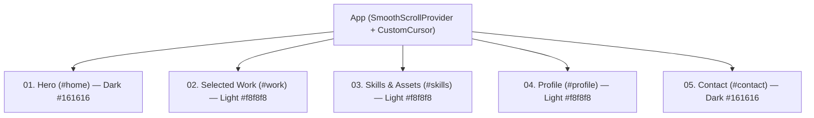

# PORTFOLIO PROJECT HANDOFF & ARCHITECTURAL SPECIFICATION

> **Session Handoff Document**  
> **Workspace**: `/home/alucard/Desktop/Portfolio/`  
> **Target Production**: Abdul Mueez Portfolio  
> **Framework Stack**: React 18, TypeScript 5.8+, Vite 6, Motion (`motion/react`), Lenis Scroll, GSAP, Reticle Verification Layer  
> **Last Updated**: November 2026

---

## 1. Project Purpose & Visual Identity

The project is an elite, high-performance developer portfolio engineered with an **Editorial Neo-Brutalist** design language. It pairs sharp Swiss typographic layout with tactile analog hardware references (CRT vector monitors, stochastic point-cloud rendering, 3D lattice geometry).

### Design Tokens & Color Palette (Strictly Locked)
- **Onyx (Deep Matte Background)**: `#161616` / `#0b0b0c`
- **Paper (Editorial Background)**: `#f8f8f8`
- **Fog (Muted Light Container)**: `#f1f1f1`
- **Graphite (Subtle Hairline Borders)**: `#3c3a3e` / `#232323`
- **Silver / Chalk (Secondary Typography)**: `#c9c7cc` / `#888888`
- **Ember (Primary Accent)**: `#ff6436`

### Typography Stack
- **Display Headings**: Anton (`.folio-display`, uppercase, tracking tight, high impact)
- **Technical Captions / HUD**: IBM Plex Mono (`font-family: var(--mono)`)
- **Body & Editorial Reading**: Inter Medium (`font-family: var(--sans)`)

---

## 2. Strict Display Copy Rules (Do Not Violate)

1. **Name Standard**:
   - Strictly display as **`Abdul Mueez`**.
   - **NEVER** include the suffix `"Shahid"` in headings, mastheads, captions, or biographical paragraphs.
2. **Location & Community Mentions**:
   - **Zero personal "Peshawar" mentions** in personal intros, bios, captions, or education blocks.
   - The **ONLY** permitted mention of "Peshawar" across the entire codebase is within the community project name: **`CNCF Peshawar`**.

---

## 3. Section Architecture Map

### 1. `Hero` (`#home` | Dark Theme: `data-cursor-theme="dark"`)
- **File**: `src/components/Hero/Hero.tsx`, `src/components/CRTMonitor/CRTMonitor.tsx`, `src/hooks/useCRTRenderer.ts`, `src/styles/hero.css`
- **Key Features**:
  - Full-viewport locked (`min-height: calc(100dvh + 2px)`) eliminating sub-pixel scroll bleed.
  - Interactive retro CRT vector monitor (`CRTMonitor.tsx`, `useCRTRenderer.ts`) running continuous 24fps phosphor `waveform` / `terrain` plot animations (artificial `4600ms` cutoff removed; guarded via `IntersectionObserver`, `ResizeObserver` dimension equality check, and `visibilitychange`).
  - Automatic `60_000ms` (`60s`) signal auto-cycling (`waveform` ↔ `terrain`) synced with the `plot` label; timer resets on manual `SWITCH SIGNAL` click and pauses under `prefers-reduced-motion: reduce`.
  - Masthead navigation: `#work`, `#skills`, `#profile`, `#contact`.
  - Real-time UTC+5 PKT clock (`usePeshawarClock.ts`).

### 2. `Selected Work` (`#work` | Light Theme: `data-cursor-theme="ember"`)
- **File**: `src/components/SelectedWork/SelectedWork.tsx`, `src/styles/work.css`
- **Key Features**:
  - Alucard AI: Autonomous agent workspace (`Gemini embeddings · Supabase pgvector · Groq` styled in `#ff6436`).
  - CNCF Peshawar: Cloud native community portal with interactive 3D SVG mascot (`PenguinMascot.tsx`; `Astro · TypeScript · Tailwind CSS · GitHub Pages` styled in `#ff6436`).
  - LeadMap: B2B pipeline discovery platform with accordion description.

### 3. `Skills & Assets` (`#skills` | Light Theme: `data-cursor-theme="ember"`)
- **Directory**: `src/components/SkillsAssets/` (`SkillsAssets.tsx`, `TechGlobe.tsx`, `techLogos.tsx`, `RetroGrid.tsx`, `HoverExpandServices.tsx`, `techData.ts`, `officialLogosData.json`, `src/styles/skills.css`, `src/assets/services/`)
- **Key Features**:
  - **Masthead**: `SKILLS & ASSETS` in Onyx `#161616` with ONLY the `&` ampersand highlighted in Ember (`#ff6436`).
  - **Part 1 — True 3D Brand Logo Icon Cloud (`TechGlobe.tsx`)**:
    - Magic UI Icon Cloud style 3D sphere centered cleanly with zero text clutter or boxed border.
    - Pure mathematical 3D Fibonacci sphere lattice with orbital coordinate rings.
    - Smooth pointer drag rotation with continuous velocity inertia and deceleration on hover.
    - 12 Official Brand SVG Logos (extracted canonical vector paths and hex colors from `simple-icons`): `Git`, `GitHub`, `Python`, `C++`, `React`, `Node.js`, `HTML5`, `CSS3`, `JavaScript`, `Cloudflare`, `Vercel`, `PostgreSQL`.
    - Integrated VengeanceUI `CursorCard` portal revealing technology category and 1-line architectural overview on hover/focus.
    - Viewport-Gated RAF Loop: Pauses `requestAnimationFrame` and state updates via `IntersectionObserver` when `#skills` is out of the viewport.
  - **Part 2 — Magic UI `@magicui/retro-grid` Background (`RetroGrid.tsx`) & Dim Ember Glow**:
    - Pure CSS 3D perspective floor grid (`perspective: 200px`, `rotateX(65deg)`, seamless `translateY` CSS keyframe loop, zero JS `rAF`, paused on `prefers-reduced-motion: reduce`), `WaveGridBackground.tsx` removed.
    - Subtle Paper horizon fade (`linear-gradient(to bottom, #f8f8f8 0%, transparent 90%)`) plus dim radial Ember backdrop (`rgba(255, 100, 54, 0.09)` → `0.03` → `transparent`) behind `TechGlobe` and service cards (`z-index: 0`).
  - **Part 3 — Services Hover-Expand Visual Strip (`HoverExpandServices.tsx`)**:
    - Skiper52 / `HoverExpand_001` horizontal hover-expanding card strip.
    - Exact 6 Services: `SAAS`, `RAG Bot`, `Portfolio`, `FullStack`, `App Development`, `Voice Agents` (`AI Agent` and `Web` removed).
    - 6 Cohesive Custom SVG Visual Artwork Plates (`src/assets/services/*.svg`) strictly adhering to the portfolio palette (Onyx, Paper, Graphite, Silver, Ember).
    - Artwork cleaned of all clipped/cramped perimeter micro-text; centered geometric compositions with internal padding.
    - Interaction: Collapsed rounded cards (`~4.8rem` desktop, `~2.25rem` mobile) that smoothly expand to `~22rem` on hover/click (`transition: { duration: 0.3, ease: "easeInOut" }`), with bottom gradient scrim and minimal code badge (`01 / SAAS` to `06 / VOICE AGENTS`).
    - Zero text walls: accordion and description paragraphs removed.
    - Zero horizontal overflow on 1440px desktop and 390px mobile viewports.

### 4. `Profile` (`#profile` | Light Theme: `data-cursor-theme="ember"`)
- **File**: `src/components/Profile/Profile.tsx`, `src/hooks/usePointPrint.ts`, `src/styles/profile.css`
- **Key Features**:
  - Gather stochastic point-cloud portrait engine (`useGatherPortrait`).
  - Flicker-Free Rendering: Deterministic seeded Mulberry32 PRNG particle layout, integer-dimension `ResizeObserver` guard (`canvas.width`/`height` only updated on actual pixel changes), cached `restBuf32`, and single-pass `ImageData` `putImageData` blit.
  - Whisper-thin HUD perimeter rulers, crosshairs, corner ticks, and coordinate trackers.
  - Interactive particle physics: cursor hover repels grain stipples locally without page lag.
  - Bio copy: "Abdul Mueez, a computer science student"; plain-text `AWS Student Builder Group` with `#ff6436` span (external `<a>` removed).
  - Education: BS Computer Science, FAST-NUCES · Batch of 2024.
  - Downloadable CV PDF (`src/assets/abdulmueez-cv.pdf`).

### 5. `Contact` & Full-Screen Sakuga Contact Page (`#contact` | Dark Theme `data-cursor-theme="dark"` → Overlay `data-cursor-theme="ember"`)
- **Files**: `src/components/Contact/Contact.tsx`, `src/components/Contact/ContactModalPage.tsx`, `src/components/Contact/RallyWordmarkBackground.tsx`, `src/styles/contact-page.css`, `src/types/sakuga.d.ts`, `public/progress.js`, `index.html` (``)
- **Key Features**:
  - **Trigger (`Contact.tsx`)**: Sole `SAY HELLO ↗` heading `<button type="button">` launches the full-screen Contact Form page (no separate `CONTACT ME` button; dialog unmounted on initial load / scroll); email copy button + social ledger preserved.
  - **Skiper26 Open (`3s` GIF-1) & Sequenced Close (`240ms` Button + `1.7s` Circle) View Transitions**: Preloads the Type 1 Giphy mask (`KBbr4hHl9DSahKvInO`) on mount/hover; open injects `3s` `cubic-bezier(0.7, 0, 0.84, 0)` `contact-gif-scale` (`0% 0` → `10% 50vmax` → `90% 50vmax` → `100% 2000vmax`). Closing (`CLOSE [ESC]` or `Escape`) plays `.contact-close-btn.is-closing` (`240ms` tactile burst via `triggerSequencedClose`), then triggers `1.7s` `cubic-bezier(0.22, 1, 0.36, 1)` `contact-circle-close` (`circle(0% at 50% 50%)` → `circle(150% at 50% 50%)` with synchronous portal unmount via `flushSync`) and immediately restores `lenis?.start()`; falls back cleanly under `prefers-reduced-motion: reduce` or unsupported View Transitions.
  - **Sakuga-Adapted Form Page (`ContactModalPage.tsx`) & On-Submit `<sakuga-progress>`**: Inspected via `skill-inspector` (`APPROVE`) and loaded via ``. Left column stays clean (`SEND A SIGNAL`, intro, `DIRECT MAILBOX`, `TIMEZONE`) with restored un-shrunk editorial proportions (`title` `clamp(3rem, 5.8vw, 5.4rem)` = `83.5px` at `1440px`), while `.sakuga-form-card` preserves balanced inputs (`52.9px`), `textarea` (`121.5px` at `1440x900`), and `52px` `SEND MESSAGE ↗`. At rest `<sakuga-progress>` is absent; on valid `SEND MESSAGE` submit, `flushSync` fades `.sakuga-form` in place (zero card collapse) and reveals `.sakuga-card-progress-layer` (`<sakuga-progress label="Sending your message">`, no `demo` attribute) centered inside `.sakuga-form-card` (`70px` above `.bar` inside shadow DOM, `182px` top / `211px` bottom clearance inside card at `1366x768`). Single-viewport fit (`overlay.scrollHeight === window.innerHeight`) holds at rest and during submit at both `1440x900` (`900/900`) and `1366x768` (`768/768`) with `0px` horizontal overflow. Drives `reset()` → `set(0.25)` → `set(0.65)` in flight → `set(1)` on delivery → `"sakuga:done"` → `SIGNAL RECEIVED` + `Send Another` reset (or returns cleanly to form + alert on error/activation). FormSubmit uses `FormData` (`headers: { Accept: 'application/json' }`) with native fallback, plus optional `VITE_WEB3FORMS_KEY`.
  - **Interactive Background (`RallyWordmarkBackground.tsx`)**: Zero-dependency React 2D `<canvas>` modeled after the live `21st.dev/@kedhareswer/components/rally-wordmark-footer` preview — rounded monoline lowercase `"hello"` contours (`HELLO_GLYPHS`), substepped high-arc gravity (`720px/s²`) bouncing Ember (`#ff6436`) ball with one-way concave escape (preventing `"e"` lower-curve trapping), `1.35s` anti-stall impulse, per-glyph `offsetY`/`tilt`/`hitFlash` springs, open-background `pointerdown` impulses on `overlayRef` skipping interactive controls, lifecycle gated on `isOpen`, and static single-frame fallback under `prefers-reduced-motion: reduce`.

---

## 4. Motion & Scroll Infrastructure

### Unified Smooth Scroll (`src/components/providers/SmoothScrollProvider.tsx`)
- Canonical Recipe A integration:
  - `<ReactLenis root autoRaf={false} options={{ lerp: 0.08, smoothWheel: true, syncTouch: false, anchors: true }}>`
  - Synced to `gsap.ticker` via `gsap.ticker.add((time) => lenis.raf(time * 1000))`.
  - `gsap.ticker.lagSmoothing(0)` prevents animation stutter during frame rate fluctuations.
  - `lenis.on('scroll', ScrollTrigger.update)` ensures scroll triggers stay in lockstep.

### Section-Adaptive Cursor (`src/components/ui/CustomCursor.tsx`)
- Exact Skiper61 Dual-Mode Mouse Follower ported to `"motion/react"`:
  - Exact Spring Constant: `SPRING = { mass: 0.1, damping: 10, stiffness: 131 }`
  - Unified Dimensions: Exact same `20px × 20px` ball diameter across all sections (no size inflation).
  - Dark Sections (`#home`, `#contact`): Crisp Paper white/silver dot (`#f8f8f8`, 20px) using direct responsive tracking (SimpleMouseFollow feel).
  - Light Sections (`#work`, `#skills`, `#profile`) & Contact Overlay: Snappy Ember orange dot (`#ff6436`, 20px) using exact SPRING physics on x, y, opacity, and scale (SpringMouseFollow feel), while closest `[data-cursor-theme]` ancestor wins — `data-cursor-theme="light"` on `#ff6436` Ember buttons forces Paper white (`#f8f8f8`) cursor contrast.
  - Repaint Optimization: Heavy blur/shadow (`box-shadow: 0 0 22px rgba(255, 100, 54, 0.4)`) removed in favor of a crisp hairline border and subtle minimal shadow (`box-shadow: 0 1px 6px rgba(255, 100, 54, 0.35)`).
  - Hide Native OS Cursor: Applied `cursor: none !important;` globally to `html, body, a, button, [role="button"], input, select, textarea, label, summary` scoped to `@media (hover: hover) and (pointer: fine)` when `prefers-reduced-motion: no-preference`.
  - Interactive Hover Feedback: Subtle reactive scale (`scale(1.25)`) on links, buttons, and inputs without inflating the resting 20px base dot size.
  - Automatic fallback: Disabled on touch screens (`pointer: coarse`, `hover: none`) and `prefers-reduced-motion: reduce`.

---

## 5. Verification & Test Evidence

### Reticle MCP Automated Assertions
- **Latest Verified Contact Session**: `s92f68e67-1b8b-4ab8-a1a6-78759f58a51f` (`s081f819d-2e63-4cc9-8b0d-8a6a0d87551e` prior to restart)
- **CRT Signal & Navigation Replay (`crt_toggle_work_profile_skills`)**: `verified: "yes"` (`verifiedReason: "proved"` — round-trip `Switch signal` toggle, CRT continuous playback past `4600ms` + live `60_000ms` auto-switch, CNCF stack text visible, Profile `AWS Student Builder Group` present with zero `<a>` link, `SKILLS & ASSETS` heading present, `consoleErrors: 0`).
- **Skills Section & Brand Cloud**: `RetroGrid` + dim radial Ember glow mounted behind `#skills`, 12 official SVG brand logos (`Git`, `GitHub`, `Python`, `C++`, `React`, `Node.js`, `HTML5`, `CSS3`, `JavaScript`, `Cloudflare`, `Vercel`, `PostgreSQL`), interactive `HoverExpandServices` (`01 / SAAS` through `06 / VOICE AGENTS`).
- **Profile Portrait Stability**: Integer-dimension `ResizeObserver` guard + deterministic Mulberry32 sampling (`hashMatchDuringIdleScroll: true`).
- **Contact Modal Flow & Live `reticle_act_and_wait`**: Post-final-edit checks on `Say hello` open (`0001`, asserting `dialog` present & `progressbar` absent at rest) and `Close contact form` (`0002`, asserting `dialog` absent) returned `verified: "yes"` (`consoleErrors: 0`). Single-viewport fit verified live (`overlay.scrollHeight === window.innerHeight` at `1440x900` = `900/900` and `1366x768` = `768/768`, `horizontalOverflowPx: 0`, `leftProgressCount: 0` both at rest and on submit). Centered on-submit `<sakuga-progress>` + `FormData` + `"sakuga:done"` → `Signal Received` → `Send Another` reset verified live at `1366x768` with an in-page `window.fetch` stub (`cardTopHeadroomAboveBarPx: 182`, `cardBottomHeadroomBelowBarPx: 211`, `fitsOneViewportOnSubmit1366: true`, `0` console errors). Rally Ember ball 3s coordinate sweeps spanned freely across the wordmark (`1440x900`: `x: 602..1194` [`spanX: 592`], `y: 133..609` [`spanY: 476`]; `1366x768`: `x: 341..1229` [`spanX: 888`], `y: 34..685` [`spanY: 651`]).
- **Reticle Flows Replay**: Post-final-edit isolated replay `faf023e232d4d6f3` (`per-flow-lease`, `38.0s`, `11 screenshots`) passed `5 of 5` Contact UI flows (`drive-clicking-say-hello-opens-contact-dialog-with-sak`, `drive-clicking-say-hello-opens-single-viewport-contact`, `drive-clicking-say-hello-triggers-1-4s-skiper26-gif-1`, `drive-opening-contact-page-via-say-hello-mounts-sakuga`, `drive-say-hello-opens-single-viewport-contact-page-wit`). Prior external-FormSubmit-dependent flows (`contact_page_sakuga_flow`, `drive-clicking-say-hello-plays-full-3s-skiper26-cloud`) are quarantined (`formsubmit.co` latency).

### Production Build Validation
- **Command**: `npm run build` (`tsc -b && vite build`)
- **Result**: Exit code `0`, 0 type errors, 510 modules transformed cleanly (`3.50s`).

---

## 6. Quick Start Guide for Next Agent

When entering a new chat session to continue work on this repository:
1. **Verify Dev Server**: Ensure Vite is running (`npm run dev` on `http://localhost:5173/`).
2. **Verify Reticle Session**: Run `reticle_session { action: "list" }` to attach to the live tab.
3. **Check Reticle Gate**: Always verify `npx @reticlehq/server gate --since HEAD~1` returns 100% pass before making new changes.
4. **Preserve Rules**:
   - Maintain color palette locks.
   - Maintain the display name `Abdul Mueez`.
   - Run `npm run build` after any TypeScript/component edits.
